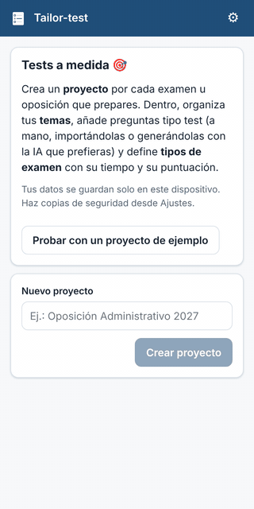
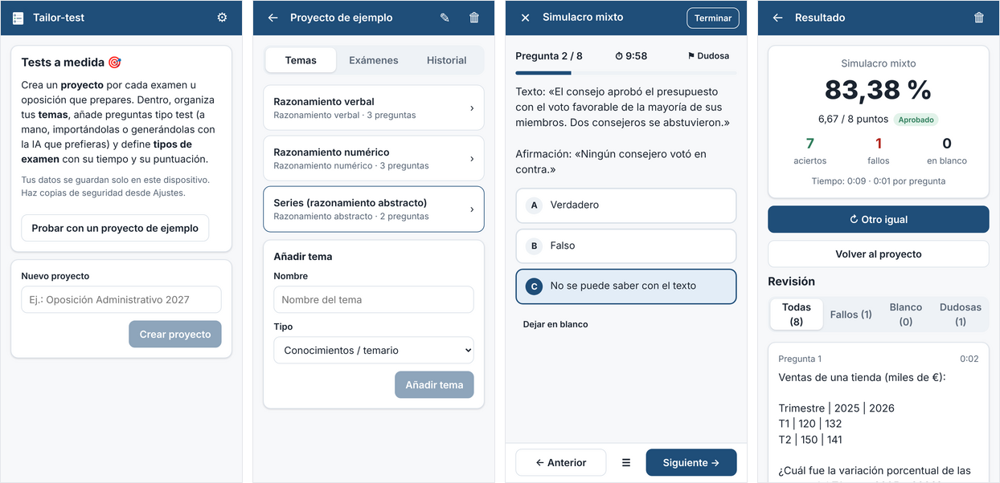

# Tailor-test · Tests a medida

[](https://github.com/Crustaxis/Exam_producer/actions/workflows/ci.yml)
[](LICENSE)
[](https://github.com/Crustaxis/Exam_producer/labels/good%20first%20issue)

<p align="center"></p>

**▶️ Pruébala ya: [crustaxis.github.io/Exam_producer](https://crustaxis.github.io/Exam_producer/)** — sin registro, desde el móvil o el ordenador.

**Tailor-test** es una app web libre y gratuita para preparar exámenes tipo test de cualquier materia:
razonamiento verbal, numérico y abstracto, temarios de oposiciones, asignaturas, certificaciones…
Se instala en el móvil como una app (PWA), funciona sin conexión y **no necesita registro**: tus datos se
quedan en tu dispositivo.

> 🇬🇧 *Tailor-test is a free, open-source, installable web app (PWA) to practise multiple-choice exams on any
> subject. Organise projects and topics, add questions by hand, import them, or generate them with any AI chat,
> and take timed mock exams with custom scoring. Data stays on your device. UI currently in Spanish; contributions
> welcome — see [How to contribute](#contribuir--contributing) below.*

## Qué puedes hacer



- **Proyectos**: uno por cada examen u oposición que prepares.
- **Temas** dentro de cada proyecto, con su material de estudio (apuntes, temario) y su banco de preguntas.
- **Preguntas tipo test** (2–6 opciones, una correcta, explicación opcional, imágenes para figuras o tablas):
  - escribiéndolas a mano,
  - importándolas desde un archivo JSON,
  - **generándolas con IA**: la app prepara el encargo a partir de tu material; lo pegas en la IA que uses
    (ChatGPT, Gemini, Claude… vale la versión gratuita) y pegas la respuesta de vuelta.
- **Tipos de examen**: número de preguntas, tiempo, temas que entran, penalización por fallo (−1/3, −1/4…),
  nota de corte, corrección al final (simulacro) o al momento (aprendizaje).
- **Hacer exámenes** con temporizador, preguntas marcadas como dudosas y guardado automático.
- **Resultados** con revisión de fallos y explicaciones, e **historial** por proyecto.
- **Copias de seguridad** para no perder nada y pasar tus tests a otro dispositivo.

## Empezar a desarrollar

Requisitos: [Node.js](https://nodejs.org) 22 o superior.

```bash
npm install
npm run dev        # servidor local en http://localhost:5173
npm test           # tests unitarios
npm run build      # versión de producción en dist/
```

Documentación técnica:

- [Arquitectura y decisiones](docs/ARQUITECTURA.md)
- [Formato de preguntas (JSON)](docs/FORMATO-PREGUNTAS.md)
- [Hoja de ruta](docs/ROADMAP.md)
- [Cómo contribuir](CONTRIBUTING.md)

## Contribuir · Contributing

**Se buscan manos**, programes o no. ¿Es tu primera vez? Sigue la
**[guía de tu primera contribución en 5 minutos](docs/PRIMERA-CONTRIBUCION.md)**: sin instalar nada.

 Cualquiera puede proponer cambios con un *fork* y un *pull request*, sin
pedir permiso: la [guía de contribución](CONTRIBUTING.md) lo explica paso a paso, también desde el navegador.

| Si sabes… | Puedes… | Empieza aquí |
|---|---|---|
| Programar (React/TypeScript) | Arreglar errores y añadir funciones | [`good first issue`](https://github.com/Crustaxis/Exam_producer/labels/good%20first%20issue) |
| Una materia de examen | Escribir un banco de preguntas originales | [`bancos/`](bancos/README.md) |
| Otro idioma | Traducir la interfaz o la documentación | [`sin código`](https://github.com/Crustaxis/Exam_producer/labels/sin%20c%C3%B3digo) |
| Usar la app | Contar errores o ideas | [Abrir un issue](https://github.com/Crustaxis/Exam_producer/issues/new/choose) |

> 🇬🇧 *Anyone can contribute via fork + pull request, no invitation needed. Code identifiers are in English;
> UI and docs are in Spanish. Issues and PRs in English are welcome. Start with a
> [good first issue](https://github.com/Crustaxis/Exam_producer/labels/good%20first%20issue).*

### Contribuidores

¡Gracias a todas las personas que han aportado!

- [@Crustaxis](https://github.com/Crustaxis) — autor
- [@jjosec16](https://github.com/jjosec16) — tiempo real en los resultados ([#1](https://github.com/Crustaxis/Exam_producer/pull/1))

<!-- Al fusionar un PR de alguien nuevo, añade su línea aquí. -->

## Licencia

[MIT](LICENSE): puedes usar, copiar, modificar y distribuir Tailor-test libremente.
